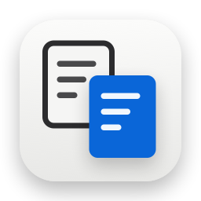
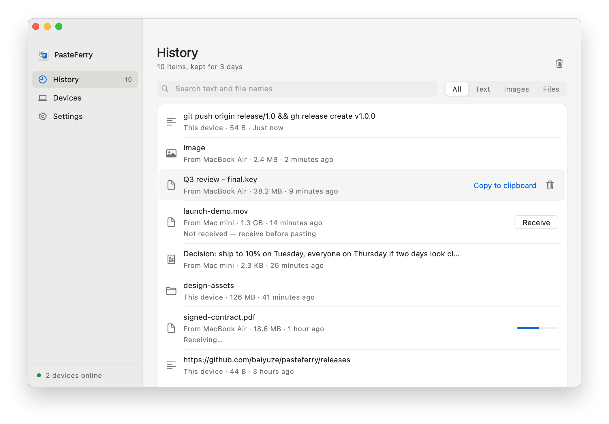
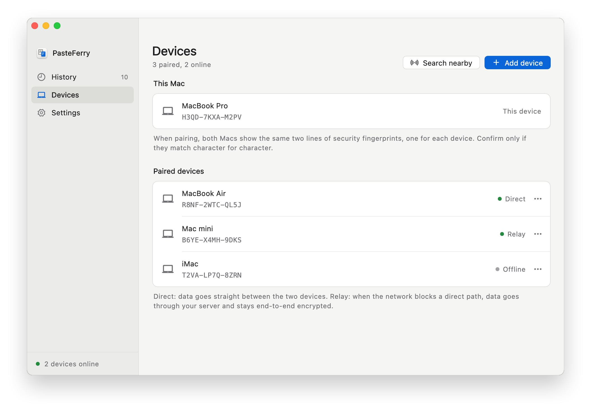
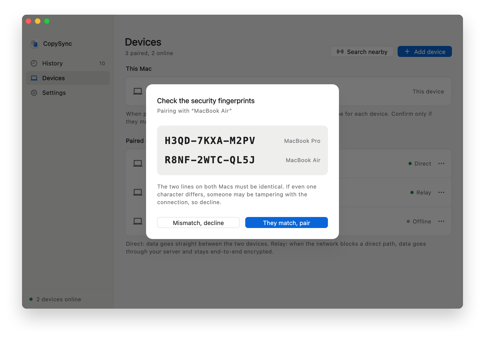

<p align="center">
  
</p>

<h1 align="center">CopySync</h1>

<p align="center">
  Copy on one computer, paste on the other. Mac and Windows both.<br>
  Text, images, files and whole folders — across accounts and across networks.
</p>

<p align="center">
  <a href="https://github.com/baiyuze/copysync/releases/latest/download/CopySync.dmg"><strong>Download for Mac</strong></a>
  ·
  <a href="https://github.com/baiyuze/copysync/releases/latest/download/CopySync-Setup.exe"><strong>Download for Windows</strong></a>
  ·
  <a href="https://baiyuze.github.io/copysync/en/">Website</a>
  ·
  <a href="README.zh-CN.md">简体中文</a>
</p>

<p align="center">
  
  
  
  
  
</p>

<p align="center">
  
</p>

## Why

Universal Clipboard needs the same Apple ID and both Macs close by. AirDrop makes you accept every time and doesn't touch the clipboard. Messaging yourself means manual downloads and your files on someone else's server. With one Mac and one Windows PC, none of the built-in options work.

With CopySync you pair two computers once. After that, copy on one and paste on the other — Mac to Mac, Mac to Windows, or Windows to Windows. On the same network it works with no server at all; across networks, a server you run yourself or Tailscale lets the two find each other. Data goes directly between the devices, end-to-end encrypted; when a direct connection can't be made, it is relayed through your server, which still can't read it.

| | CopySync | Universal Clipboard | AirDrop | Chat apps |
|---|:-:|:-:|:-:|:-:|
| Different Apple IDs | ✓ | — | Needs accepting | ✓ |
| Different networks (home ↔ office) | ✓ | — | — | ✓ |
| Paste right away, nothing to accept | ✓ | ✓ | — | — |
| Between Mac and Windows | ✓ | — | — | ✓ |
| Files and whole folders | ✓ | Unreliable | ✓ | Zipped |
| History of what you copied | ✓ | — | — | Scroll back |
| Content stays off third-party servers | ✓ | ✓ | ✓ | — |

## Features

- **Text, rich text, images, files and folders.** What you copy is what comes out on the other side.
- **Size-aware transfer.** Anything under 50 MB (adjustable) is pushed as soon as you copy; larger files sync as a record you pull when you need them.
- **History** of the last 3 days (adjustable) across all your computers, with image preview.
- **No server on the same network.** Computers find each other and pair with a code; on a different subnet you also enter an address.
- **Direct first, relay as fallback**, including office networks with several uplinks.
- **Fingerprint check when pairing**, so neither the server nor anyone on the network can impersonate your device.
- **Runs in the background**, starts at login, recovers from crashes. English, Chinese and Japanese.

<table>
  <tr>
    <td></td>
    <td></td>
  </tr>
</table>

## Get started

New here? The **[quick start](https://baiyuze.github.io/copysync/en/start/)** walks through it with screenshots. You need **the app on each computer**. On the same network that's all; across networks, add a server or Tailscale.

**1. Install the app** on each computer: [CopySync.dmg](https://github.com/baiyuze/copysync/releases/latest/download/CopySync.dmg) for macOS 13+, [CopySync-Setup.exe](https://github.com/baiyuze/copysync/releases/latest/download/CopySync-Setup.exe) for Windows 10/11 ([portable zip](https://github.com/baiyuze/copysync/releases/latest/download/CopySync-windows-x64.zip)). The builds aren't notarized or code-signed yet: on Mac, allow it once under **System Settings → Privacy & Security → Open Anyway**; on Windows, click **More info → Run anyway**. Then click **Turn on background sync**, and allow CopySync when Windows Firewall asks, or when macOS asks to find devices on your local network.

**2. Pair.** On one computer, **Devices → Add device → Show a code**; on the other, **Enter a code**. On a different subnet, click **On a different subnet?** and also enter the address shown under the code. Confirm only if both screens show the same two fingerprint lines. From then on, copy on either one and paste on the other.

**3. Across networks (optional).** Three ways to connect, each with a step-by-step guide:

| Way | Best for | You need |
|---|---|---|
| **[Same network](https://baiyuze.github.io/copysync/en/lan/)** | Computers behind one router, at home or in the office | Nothing |
| **[Public server](https://baiyuze.github.io/copysync/en/cloud/)** | Computers on different networks that should sync from anywhere | A Linux VM with a public IP; the smallest is enough |
| **[Tailscale](https://baiyuze.github.io/copysync/en/tailscale/)** | Across networks without a server | [Tailscale](https://tailscale.com) on every computer; enter the other's Tailscale address when pairing |

On a public server:

```bash
curl -LO https://github.com/baiyuze/copysync/releases/latest/download/copysync-server-linux-amd64.tar.gz
tar xzf copysync-server-linux-amd64.tar.gz && cd copysync-server-linux-amd64
sudo ./install.sh <public IP of the server>
```

Open TCP 8787, UDP 3478 and UDP 32768–60999, then enter `ws://<server address>:8787/signal` under **Settings → Signaling server** on each computer. Docker and all options: [server deployment guide](server/deploy/README.md).

| | Requirement |
|---|---|
| **Mac app** | macOS 13 Ventura or later; Intel and Apple silicon |
| **Windows app** | Windows 10 (21H2 or later) and 11, x64 |
| **Server** | Optional, only to sync across networks: Linux (x86_64, ARM64; systemd or Docker), macOS, or Windows 10/11 x64 |
| **iPhone / iPad** | Not supported: iOS doesn't let apps watch the clipboard in the background |

## Documentation

- [How it works](guide/how-it-works.md): architecture, NAT traversal, security model, fallbacks, lessons learned
- [Troubleshooting](guide/troubleshooting.md) and known limitations
- [Quick start](https://baiyuze.github.io/copysync/en/start/) · [Same network](https://baiyuze.github.io/copysync/en/lan/) · [Public server](https://baiyuze.github.io/copysync/en/cloud/) · [Tailscale](https://baiyuze.github.io/copysync/en/tailscale/) · [Run a server on your LAN](https://baiyuze.github.io/copysync/en/server/), all with screenshots
- [Server deployment](server/deploy/README.md): Windows, macOS, Linux, Docker, Tailscale
- [Building from source](guide/building.md)
- Design notes (Chinese): [Local network mode](design/lan-mode.md), [NAT traversal on multi-uplink networks](design/nat-traversal.md), [Windows client](design/windows-client.md)
- [Changelog](CHANGELOG.md)

## License

CopySync is dual-licensed. It's free under the [GNU AGPL-3.0](LICENSE): anyone, companies included, can use and modify it, but distributing it or offering a modified version over a network means publishing your source under the same license. A [commercial license](LICENSING.md) is available for closed-source products, private modifications and hosted services; [open a "Commercial license" issue](https://github.com/baiyuze/copysync/issues/new?template=commercial-license.yml) to ask. Versions 1.2.0 and earlier remain under the MIT License.
