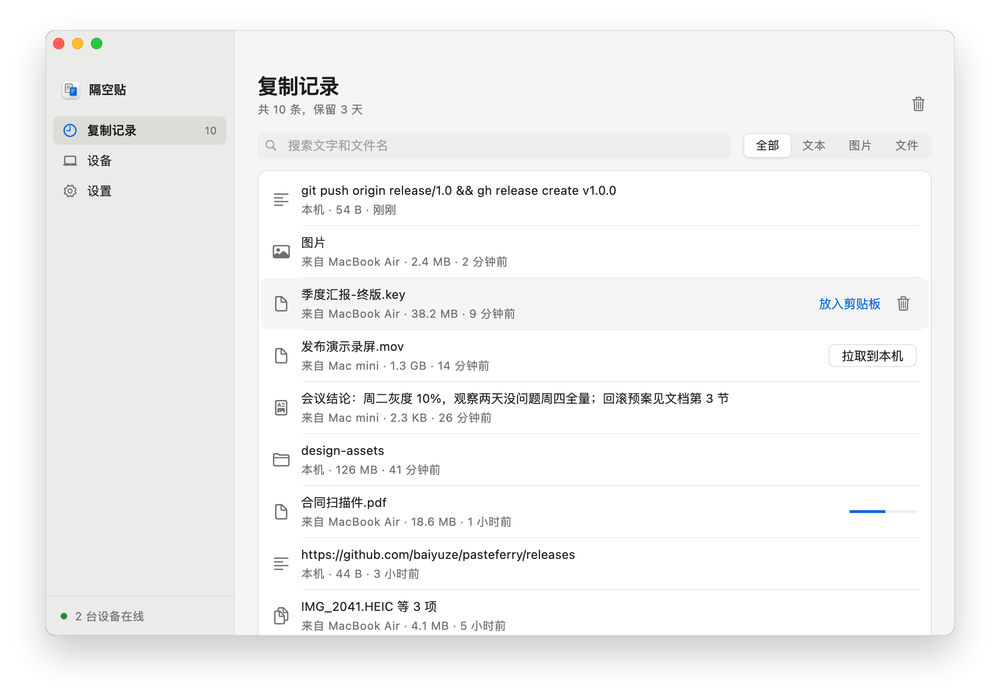
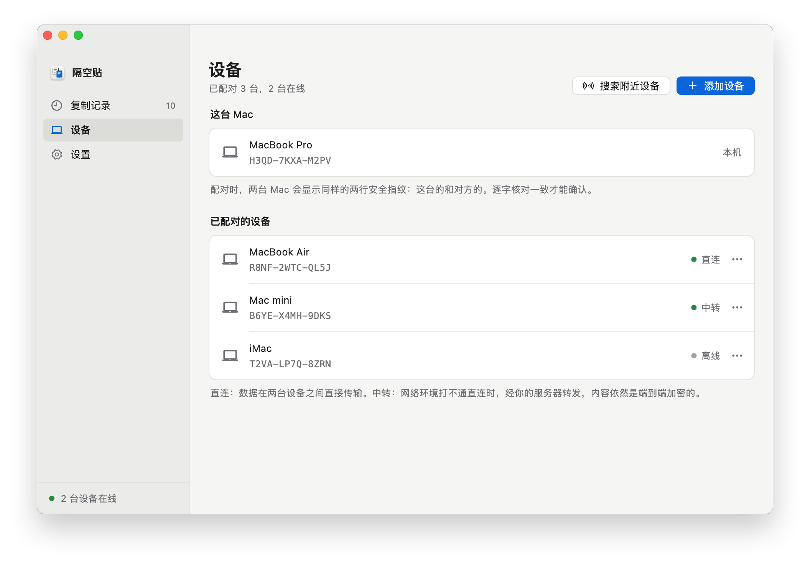
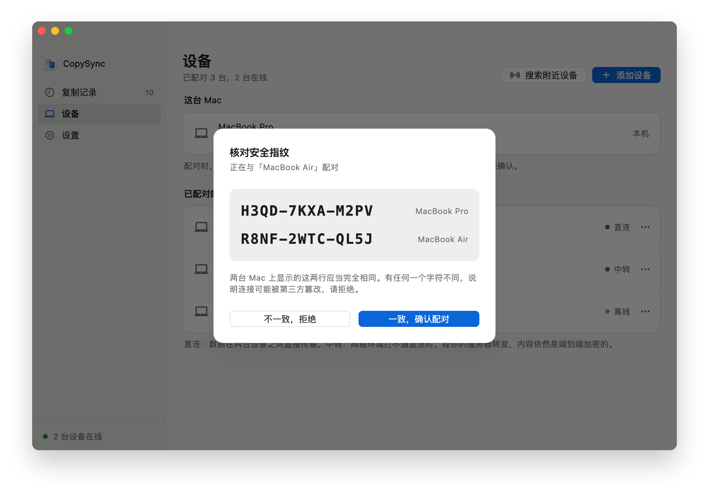

<p align="center">
  
</p>

<h1 align="center">CopySync</h1>

<p align="center">
  在这台电脑复制，到那台电脑粘贴。Mac、Windows、Linux 互通。<br>
  文本、图片、文件、整个文件夹都可以，不限账号，不限是否在同一个网络。
</p>

<p align="center">
  <a href="https://baiyuze.github.io/copysync/download/"><strong>下载</strong></a>
  ·
  <a href="https://baiyuze.github.io/copysync/">项目主页</a>
  ·
  <a href="README.md">English</a>
</p>

<p align="center">
  
  
  
  
  
</p>

<p align="center">
  
</p>

## 它解决什么问题

通用剪贴板要同一个 Apple ID、两台离得近；隔空投送每次都要点接收，也不管剪贴板；发给自己要手动下载，文件还留在别人的服务器上。一台 Mac、一台 Windows 时，系统自带的办法一个都用不了。

CopySync 的做法是：两台电脑配对一次，之后在一台上复制，另一台上直接粘贴。Mac 与 Mac、Mac 与 Windows、Windows 与 Windows 都可以。同一个网络里装好就能用，不需要服务器；跨网络时，由你自己部署的服务器或 Tailscale 让两台电脑找到彼此。数据在两台设备之间直接传输，全程端到端加密，打不通直连时经你的服务器中转，服务器也看不到内容。

| | CopySync | 通用剪贴板 | 隔空投送 | 聊天软件 |
|---|:-:|:-:|:-:|:-:|
| 不同 Apple ID 之间 | ✓ | — | 需对方接收 | ✓ |
| 不在同一个网络（家里 ↔ 公司） | ✓ | — | — | ✓ |
| 复制后直接粘贴，不用点接收 | ✓ | ✓ | — | — |
| Mac 与 Windows 之间 | ✓ | — | — | ✓ |
| 文件与整个文件夹 | ✓ | 不稳定 | ✓ | 打包后可以 |
| 复制历史，可以找回之前的内容 | ✓ | — | — | 翻聊天记录 |
| 内容不经过第三方服务器 | ✓ | ✓ | ✓ | — |

## 功能

- **文本、带格式的文本、图片、文件、文件夹**都能同步。复制什么，对面粘贴出来就是什么。
- **按大小分流**：50 MB 以内（可调）复制时直接推送；更大的文件只同步一条记录，需要时再拉取。
- **复制记录**：所有设备上最近 3 天（可调）复制过的内容，图片可以预览。
- **同一网络里不需要服务器**：自动发现，输入配对码就能用；不在同一网段时多输一个地址。
- **直连优先，自动中转**，公司双线这类多出口网络也能直连。
- **配对时核对安全指纹**，防止服务器或网络上的第三方冒充你的设备。
- **后台常驻**，开机自启，崩溃自动恢复。中文、英文、日文界面。

<table>
  <tr>
    <td></td>
    <td></td>
  </tr>
</table>

## 开始使用

第一次用？跟着**[快速开始](https://baiyuze.github.io/copysync/start/)**一步步来，有截图。需要**每台电脑装一个 App**；同一个网络里这就够了，跨网络时再加一台服务器或 Tailscale。

**1. 在每台电脑上安装 App**，到 **[下载页](https://baiyuze.github.io/copysync/download/)** 选：

- **Mac**（macOS 13 以上）：[Apple 芯片版](https://github.com/baiyuze/copysync/releases/latest/download/CopySync-mac-apple-silicon.dmg)或 [Intel 版](https://github.com/baiyuze/copysync/releases/latest/download/CopySync-mac-intel.dmg)；也有两种芯片都能用的[通用版](https://github.com/baiyuze/copysync/releases/latest/download/CopySync.dmg)。
- **Windows** 10/11：[安装程序](https://github.com/baiyuze/copysync/releases/latest/download/CopySync-Setup.exe)或[便携版](https://github.com/baiyuze/copysync/releases/latest/download/CopySync-windows-x64.zip)。
- **Linux**（X11，或带 XWayland 的 Wayland 桌面）：Ubuntu、Debian 用 `.deb`（[x64](https://github.com/baiyuze/copysync/releases/latest/download/CopySync-linux-amd64.deb)、[ARM64](https://github.com/baiyuze/copysync/releases/latest/download/CopySync-linux-arm64.deb)），其他发行版用 `tar.gz`（[x64](https://github.com/baiyuze/copysync/releases/latest/download/CopySync-linux-amd64.tar.gz)、[ARM64](https://github.com/baiyuze/copysync/releases/latest/download/CopySync-linux-arm64.tar.gz)），解压后运行 `./CopySync/install.sh` 加进应用菜单。

还没有公证和代码签名：Mac 上第一次打开时到 **系统设置 → 隐私与安全性** 点 **仍要打开**；Windows 上点 **更多信息 → 仍要运行**。然后点 **启用后台同步**。Windows 防火墙询问、macOS 询问能否查找本地网络上的设备时，都选择允许。

**2. 配对。**一台点 **设备 → 添加设备 → 生成配对码**，另一台点 **输入配对码**；不在同一网段时，再点 **不在同一网段？** 输入配对码下面显示的地址。两边显示的两行安全指纹完全一致后再确认。之后在任意一台上复制，另一台就能直接粘贴。

**3. 跨网络时（可选）。**三种连接方式，每种都有图文教程：

| 方式 | 适合 | 要准备 |
|---|---|---|
| **[同一网络](https://baiyuze.github.io/copysync/lan/)** | 电脑都连着同一个路由器（家里或办公室） | 什么都不用 |
| **[公网服务器](https://baiyuze.github.io/copysync/cloud/)** | 电脑分散在不同网络里，想在哪儿都能同步 | 一台有公网 IP 的 Linux 云主机，最低配置就够 |
| **[Tailscale](https://baiyuze.github.io/copysync/tailscale/)** | 要跨网络，但没有公网服务器 | 每台电脑都装 [Tailscale](https://tailscale.com)，配对时输入对方的 Tailscale 地址 |

公网服务器上的安装命令：

```bash
curl -LO https://github.com/baiyuze/copysync/releases/latest/download/copysync-server-linux-amd64.tar.gz
tar xzf copysync-server-linux-amd64.tar.gz && cd copysync-server-linux-amd64
sudo ./install.sh <服务器公网IP>
```

放行 TCP 8787、UDP 3478 与 UDP 32768–60999，然后在每台电脑的 **设置 → 信令服务器地址** 填入 `ws://<服务器地址>:8787/signal`。Docker 部署与全部参数见[服务器部署说明](server/deploy/README.md)。国内云服务器的域名没有备案时，客户端里请直接填 IP。

| | 要求 |
|---|---|
| **Mac 客户端** | macOS 13 Ventura 及以上；Apple 芯片与 Intel 芯片 |
| **Windows 客户端** | Windows 10 与 11，x64 |
| **Linux 客户端** | x64 或 ARM64；X11 桌面，或带 XWayland 的 Wayland 桌面（GNOME、KDE 默认都带）；GTK 3 |
| **服务器** | 可选，只在跨网络时需要：Linux（x86_64、ARM64；systemd 或 Docker）、macOS，或 Windows 10/11 x64 |
| **iPhone / iPad** | 暂不支持：iOS 不允许 App 在后台监听剪贴板 |

## 文档

- [工作原理](guide/how-it-works.zh-CN.md)：架构、NAT 打洞、安全模型、兜底、踩过的坑
- [排障](guide/troubleshooting.zh-CN.md)与已知限制
- [快速开始](https://baiyuze.github.io/copysync/start/) · [同一网络](https://baiyuze.github.io/copysync/lan/) · [公网服务器](https://baiyuze.github.io/copysync/cloud/) · [Tailscale](https://baiyuze.github.io/copysync/tailscale/) · [在局域网里部署服务器](https://baiyuze.github.io/copysync/server/)，都是图文教程
- [服务器部署说明](server/deploy/README.md)：Windows、macOS、Linux、Docker、Tailscale
- [从源码构建](guide/building.zh-CN.md)
- 技术方案：[局域网直连](design/lan-mode.md)、[多出口网络的 NAT 打洞](design/nat-traversal.md)、[Windows 客户端](design/windows-client.md)
- [更新记录](CHANGELOG.md)

## 许可

CopySync 以 [GNU AGPL-3.0](LICENSE) 免费开源：任何人（包括公司）都可以使用和修改，但分发它、或通过网络提供修改过的版本时，必须以同样的许可公开你的源码。详见 [LICENSING.md](LICENSING.md)。1.2.0 及更早的版本仍适用 MIT 许可。
